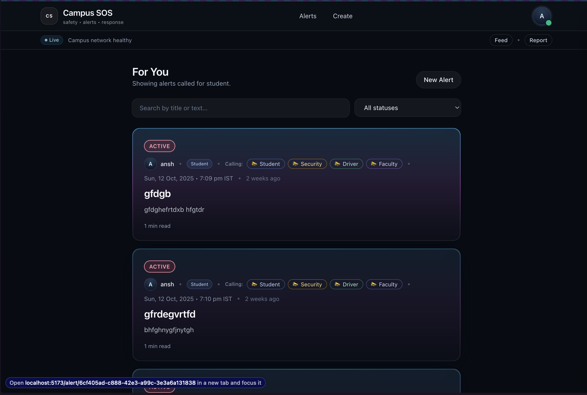
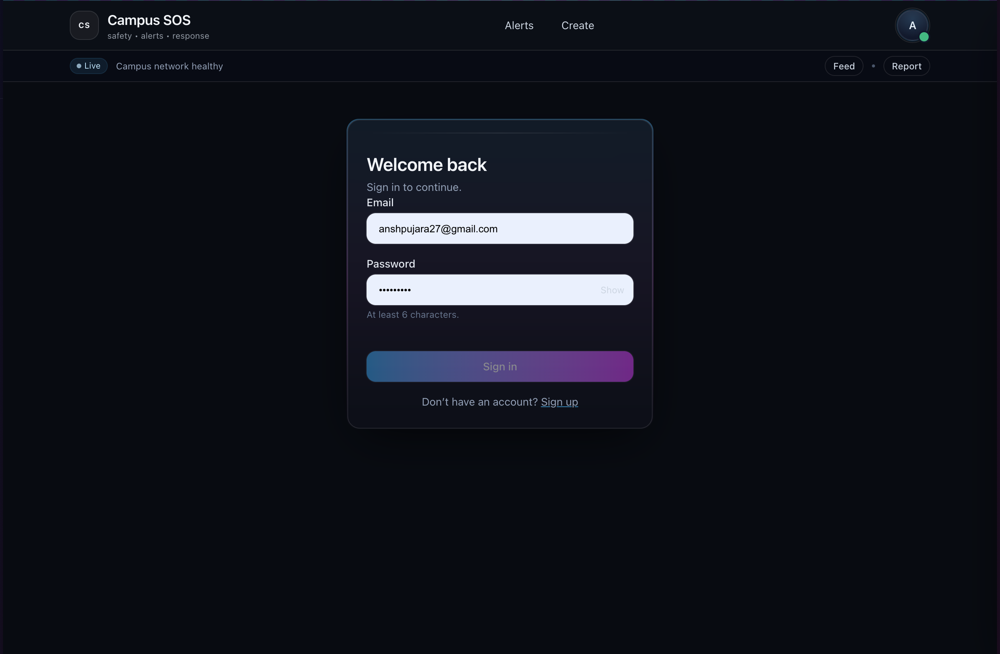
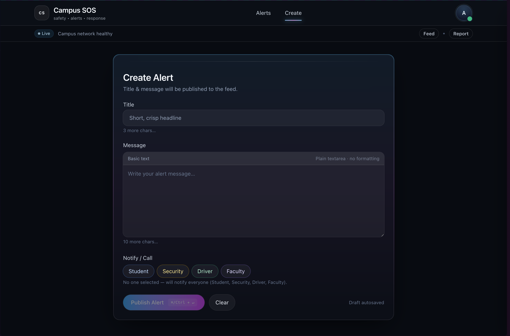

<h1 align="center">🚨 Campus SOS — Real-Time Campus Alert & Safety System</h1>

<p align="center">
  
  
  
  
  
</p>

<p align="center">
  <strong>⚡ Real-time, multi-role campus alert system with location tracking, SSE streaming, and map overlays.</strong>
</p>

<p align="center">
  <a href="https://e2b21f1b.campus-sos-frontend.pages.dev/" target="_blank">
    🔗 <b>Live Demo</b>
  </a>
  &nbsp;|&nbsp;
  <a href="https://github.com/Anshpujara5/campus-sos" target="_blank">
    📦 <b>Repository</b>
  </a>
</p>

---

## 🧭 Overview

**Campus SOS** is a **real-time campus safety platform** that connects students, guards, drivers, and faculty.  
It enables **instant alerts, live tracking**, and **role-based dashboards** — all running on **Cloudflare Workers** with blazing-fast updates under **1 second**.

### 🎯 Key Features
- 🧑‍🎓 **Multi-role dashboards:** Student, Guard, Driver, Faculty
- 🌍 **Live map updates:** Leaflet-based campus visualization with zone overlays
- ⚡ **Instant alerts (<1s):** via Server-Sent Events (SSE)
- 🔒 **JWT authentication:** Secure and stateless
- 🧩 **Cloudflare Workers + Prisma:** Edge-first serverless design
- 🗺️ **Geo-fencing support:** Detects movement across campus zones
- 📡 **Low-latency communication:** Persistent connections via SSE stream

---

## 🧠 Tech Stack

| Layer | Technology |
|:------|:------------|
| **Frontend** | React + Vite + TailwindCSS |
| **Backend** | Hono (Cloudflare Workers) |
| **Database** | PostgreSQL (Neon) |
| **ORM** | Prisma |
| **Real-time** | Server-Sent Events (SSE) |
| **Map** | Leaflet + OpenStreetMap |
| **Auth** | JWT |
| **Hosting** | Cloudflare Pages + Workers |

---

## 📸 Screenshots

<p align="center">
  
  <br/><br/>
  
  <br/><br/>
  
</p>
---

## ⚙️ Quickstart

Clone the repository and set up your environment:

```bash
git clone https://github.com/Anshpujara5/campus-sos
cd campus-sos
cp .env.example .env   # Fill in your secrets
npm ci
npm run dev
